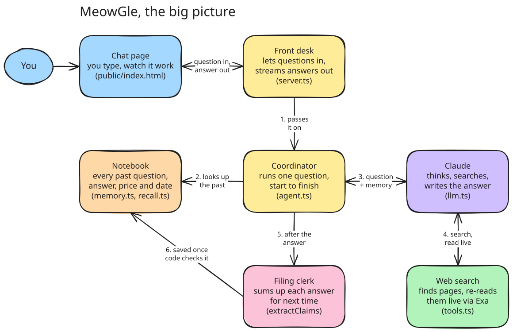
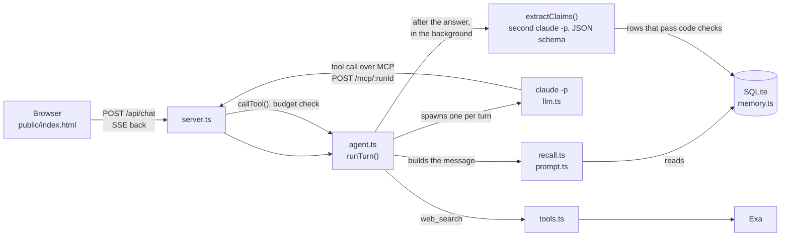

# Design

MeowGle is a chat agent with one tool, web search. It remembers what you asked, what it answered, and when. I built it against the brief's three goals: answer fast, get it right, be good to talk to.

## The big picture

You ask on the chat page. The coordinator pulls what MeowGle remembers and hands it to Claude with your question. Claude searches the web until it can answer. Once the answer is out, a filing clerk writes down what's worth keeping, and code checks every line before it lands in the notebook.

To edit the picture, open [docs/overview.excalidraw](docs/overview.excalidraw) on excalidraw.com.

## Architecture

The same flow with the real call paths:

The model runs inside Claude Code's CLI. I own everything around it: the message it starts from, the one tool it can call, and what gets saved afterwards.

## One turn

1. `server.ts` takes the message and opens an SSE stream back to the browser.
2. `runTurn()` saves the question first, so a crash still leaves a record.
3. `recall.ts` and `prompt.ts` build the opening message: the date strip, what you've told it about yourself, this chat, and whatever past chats match.
4. `llm.ts` spawns `claude -p` with every built-in tool off and an MCP config pointing at `/mcp/<run id>` on my own server.
5. Each tool call lands back in `runTurn()`. It checks the budget, runs the search against Exa, and pushes progress ("searching", "reading 3 pages (live)") into the same queue as the model's text. The UI gets one ordered stream.
6. The answer gets cleaned, streamed and saved with the sources it cited, plus a full record of what went into the model.
7. A second Claude call files the turn into long-term memory in the background. You never wait on it.

Effort sets the budget: 3, 6 or 12 tool calls. Every tool result tells the model how many it has left.

## The tool

`web_search` takes `queries`, `urls`, or both, and runs them in parallel in one call.

- **Queries find pages.** They use Exa's `lite` search. I measured 0.8 to 1s per call, against 1.6 to 2.4s for `auto`.
- **URLs read pages.** That's where freshness comes from. A URL MeowGle has cited before is always crawled live. Anything else takes a copy at most a day old.
- **Every page comes back tagged** `live`, `cached copy` or `FAILED`, straight from Exa's own status field. Exa sometimes serves a cached copy even when asked for a live one, so the model has to say when a number came from one.

## Memory

SQLite through `node:sqlite`. The model never asks for memory. Code decides what each message carries.

### Writing

After every answer, a second Claude call files the turn. It writes a one-line summary that names every option the reply listed and which one it picked, labels, up to six values worth re-checking later (each tied to its page), and anything you said about yourself.

I don't trust any of it until code checks it. A value has to appear in the answer and on a page this turn actually read. A summary can't mention a number nobody said. A fact about you has to come from your own words. Read dates come from the source record, never from the model.

Saved values are never overwritten. A newer reading of the same value from the same site points the old row at the new one (`superseded_by`), so "$19 on the 2nd, $25 now" stays answerable.

### Reading

Every message opens with the local time and the last 14 days written out with weekdays. "Last Tuesday" is a lookup.

Then, in order:

- What you've said about yourself.
- This chat. Older replies come in as their summaries, the latest one whole with its pages.
- Past chats. SQLite FTS5 searches the question, reply, summary, labels and surrounding chat. BM25 rank gets fused with recency, and a named day ("on Monday") adds a third ranked list.

Most messages get at most three dated one-liners from past chats. When a message points back ("you said", "on Monday", or one past exchange clearly covers it), the matching exchanges come in full: the reply, its pages with read dates, the saved values, and the log of every question.

### Checking

For "is it still right?", the model re-opens the stored pages live and gives every old value one verdict: unchanged, changed (old to new, cited), or couldn't verify.

## Cleanup and inspection

Text the model streams before a tool call is narration, so it moves into the thinking trail. Citations get normalized to `[n]`, and any citation that doesn't match a source from this turn gets dropped.

Each turn saves exactly what went into the model: the system prompt, the message, and every tool call with the text it returned. The UI's Context panel shows it. Any answer can be traced back to what the model actually saw.

## Why I built it this way

- **The CLI as the model runtime.** One code path for a Claude subscription or an API key. One pinned dependency that is the runtime itself. A tool loop I didn't have to write. The cost is a process per turn.
- **Memory outside the tool.** The model never spends a round trip remembering, and the context is the same every time for the same history.
- **Search finds, reading verifies.** A fast cached index is fine for finding the right page. Trusting a number needs the page itself.
- **Dates in code.** Models are bad at date arithmetic, so I write the calendar out for them.
- **Remember answers too.** My first cross-chat memory carried every past question plus a few saved numbers. The model never saw its own replies from other chats, so "the tools you shortlisted on Monday" got "I don't have enough context". Filing a summary of every reply, and pulling in the full exchange when a message points back, fixed it for about 300 to 550 extra tokens on an ordinary turn.

## What I tried and dropped

I rebuilt this twice before it landed.

**v1 was a fixed pipeline on Gemini.** A fast planner wrote the queries, code ran them, a review step decided on another round, then the main model answered. The planner wrote its plan before seeing a single result. It spread across 20 files I couldn't explain in one sitting, and Gemini rate limits kept killing turns.

**v2 was a single loop on Bedrock's gpt-oss-120b.** The loop was right, so it stayed. The model went. It had its own citation syntax and odd unicode (the cleanup in `agent.ts` still handles both), and I wanted Claude without paying per token through the SDK.

Smaller things I cut:

- **Two tools**, `web_search` and `open_page`. The brief says one tool, and merging them saved a round trip whenever the model needed both.
- **Memory as tools.** Breaks the one-tool rule and adds a round trip.
- **The full question log on every turn.** The model mined it for small talk. That feels like being watched.
- **Embeddings.** A dependency or an API call per message. For one person's history, dates and good summaries matter more than similarity.
- **An LLM merging memories**, Mem0-style. Lossy, and I want the old value on record.
- **A prompt made of rules.** Word counts and format bans made every answer the same size and shape. The prompt is now prose in MeowGle's voice with short example exchanges.

## With another week

- **An eval harness** from the brief's example questions plus traps: a day with nothing on it, a price that changed after it was saved. Score correct answers, invented memories and time to first token.
- **Embeddings as a third ranked list** in recall, from a small local model, so a paraphrase that shares no words with an old exchange still lands.
- **One warm model process** instead of one per turn, to cut the startup cost.
- **Trim the question log** to the matched days once history passes a few thousand questions.
- **Split `memory.ts`**, which grew past 700 lines.
